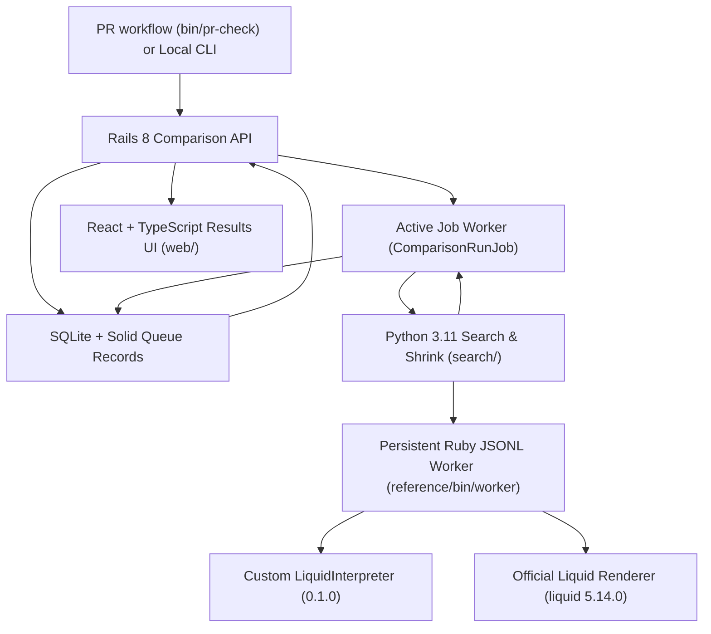

# Shopify Liquid Regression Finder

`liquid-regression-finder` is a pull-request and CLI analysis tool that compares `before` and `after` Shopify Liquid product-card snippets, deterministically searches for a product fixture where sale-badge presence (`[data-regression-badge="sale"]`) diverges, verifies both outputs against the official `liquid` Ruby gem (`5.14.0`), minimizes the counterexample, and outputs a replayable bundle with trace-anchored source explanations.

The public API, web UI, and PR workflow analyze standalone product-card fragments for the `sale_badge` observer. The Dawn corpus benchmark extends the same engine with benchmark-only `sold_out_badge` and `price_range` observers.

---

## Architecture



| Path | Purpose |
| --- | --- |
| [`interpreter/`](interpreter/) | Custom UTF-8 Liquid lexer, parser, AST, evaluator, tracer, resource limits, and `liquid-spec` adapter |
| [`reference/`](reference/) | Official `liquid 5.14.0` renderer, `PROJECTION_VERSION = "1.0.0"`, Nokogiri HTML observer, storefront probe, and JSONL worker |
| [`search/`](search/) | Python 3.11 stdlib-only deterministic generator (`1.0.0`), search engine, lexicographic shrinker, trace-aligned explainer, and CLI (`compare`, `replay`) |
| [`contracts/`](contracts/) | Draft 2020-12 JSON Schemas, valid/invalid examples, schema tests, and frozen `liquid-spec` conformance manifest |
| [`bench/`](bench/) | Verified 15-case `Shopify/dawn` corpus, `shopifypartners/product-csvs` sample baseline (`60` products), benchmark runner, and generated reports |
| [`fixtures/`](fixtures/) | Demo snippets (`fixtures/demo/`), ordinary parity controls (`fixtures/ordinary/`), Dawn witnesses (`fixtures/witnesses/`), and storefront probe matrix |
| [`snippets/`](snippets/) | Watched repo-relative snippet [`snippets/card-product.liquid`](snippets/card-product.liquid) configured by [`comparison-manifest.json`](comparison-manifest.json) |
| [`api/`](api/) | Rails `8.1.4.1` API-mode server, SQLite persistence, Solid Queue worker, lease reconciliation, and log redaction |
| [`web/`](web/) | React `19.3.1` + TypeScript `5.9.3` submission/results UI, Vite dev proxy, Vitest tests, Playwright E2E, and Vercel API handlers |
| [`bin/`](bin/) | [`bin/setup`](bin/setup), [`bin/check`](bin/check), [`bin/pr-check`](bin/pr-check), [`bin/pr_dry_run`](bin/pr_dry_run), and [`bin/verify_clean_checkout`](bin/verify_clean_checkout) |
| [`.github/workflows/`](.github/workflows/liquid-regression.yml) | CI verification and fork-safe PR snippet check workflow |

---

## Pinned Toolchain & One-Command Setup

Pinned tool and lockfile versions (full inventory in [`docs/toolchain-versions.md`](docs/toolchain-versions.md)):

- **Ruby**: `3.3.13` (`.ruby-version`), **Bundler**: `4.0.23` (`liquid 5.14.0`, `liquid-spec 2.0.0` @ `84bf25e0edbca5f7e530574788b0f875ab331f50`, `nokogiri 1.19.7`, `json_schemer 2.5.0`, `rails 8.1.4.1`, `solid_queue 1.7.2`, `sqlite3 2.10.2`)
- **Python**: `3.11.18` (`.python-version`) — 100% standard library across [`search/`](search/) and [`bin/pr-check`](bin/pr-check)
- **Node.js**: `24.15.0` (`.node-version`), **npm**: `11.12.1` (`react 19.3.1`, `typescript 5.9.3`, `vite 7.3.8`, `vitest 3.2.7`, `playwright-core 1.65.1`)

Install all locked dependencies and verify every stage gate (`stage-1` through `stage-10`) from a clean checkout:

```sh
./bin/setup
./bin/check all
```

Run an individual stage gate or standalone clean-checkout verification:

```sh
./bin/check stage-10
./bin/verify_clean_checkout
```

---

## CLI Quickstart (`search`)

Run deterministic counterexample search + shrink + explanation on the demo snippets (outputs machine-readable JSON to `stdout`, diagnostics to `stderr`):

```sh
python3.11 -m search compare \
  --before fixtures/demo/before.liquid \
  --after fixtures/demo/after.liquid \
  --observer sale_badge \
  --seed 0 \
  --search-pairs 256 \
  --shrink-pairs 128 \
  --replay-out artifacts/stage-5/demo-replay.json
```

Replay a saved canonical `ReplayBundle` in a fresh process without search or shrink:

```sh
python3.11 -m search replay --bundle artifacts/stage-5/demo-replay.json
```

From the Stage 5 demo artifacts ([`artifacts/stage-5/demo-compare.json`](artifacts/stage-5/demo-compare.json)):
- `compare` discovers a counterexample at candidate index `55` (`56` search pairs), minimizes it to `2` variants in `28` shrink pairs (`local_fixed_point: true`), confirms `before.observed=true` vs `after.observed=false` in both `LiquidInterpreter` (`0.1.0`) and official `liquid 5.14.0`, and reports a `structural_change` explanation linking `before` line `3` (`variant_id="v2"`) to `after` line `1`.
- `replay` reproduces identical HTML outputs, trace events, and official Liquid observations ([`artifacts/stage-5/demo-replay-result.json`](artifacts/stage-5/demo-replay-result.json)).

### CLI Exit Codes

| Command | Exit `0` | Exit `1` | Exit `2` |
| --- | --- | --- | --- |
| `python3.11 -m search compare` | `no_difference_found` (`"no difference found within this search"`) | `difference_found` (confirmed by official Liquid) | Validation/syntax/limit error, `reference_mismatch`, worker/timeout/CLI error |
| `python3.11 -m search replay` | `replayed` (exact digest, version, HTML, trace, and parity match) | — | Tampered bundle, hash/version mismatch, or execution error |
| `./bin/pr-check` | `no_difference_found` or `skipped_untrusted_fork` | `difference_found` or terminal job `failed` | Missing/renamed git blob, invalid manifest, poll timeout, HTTP/infra error |

---

## Web App & API Local Launch (`api/` + `web/`)

1. Start the Rails API and single Solid Queue worker (terminal 1 & 2):

```sh
cd api
bundle exec bin/rails db:prepare
bundle exec bin/jobs
```

```sh
cd api
bundle exec bin/rails server -b 127.0.0.1 -p 3000
```

2. Start the React + Vite frontend (terminal 3; `/api` requests proxy to `VITE_API_ORIGIN`, defaulting to `http://127.0.0.1:3000`):

```sh
cd web
npm run dev
```

3. Endpoints:
   - `GET /api/v1/health` -> `200 {"status":"ok"}`
   - `POST /api/v1/comparisons` -> `202` queued `ComparisonJob` (`200` on terminal idempotency replay, `409` on same `Idempotency-Key` with different whitespace-sensitive request digest, `422` on schema/size/observer errors, `401` if `LIQUID_REGRESSION_API_TOKEN` is set and bearer auth fails)
   - `GET /api/v1/comparisons/:id` -> `200 ComparisonJob` or `404`
   - UI routes: `/` (submission form) and `/comparisons/:id` (polling status, variant table, derived `product` fields, safely escaped HTML outputs, highlighted source anchors, expandable event traces, and `replay.json` download).

---

## HTML Observer Contract

Public `sale_badge` comparisons parse rendered HTML fragments with Nokogiri (`Nokogiri::HTML5.fragment`, implemented in [`observer.rb`](reference/lib/liquid_reference/observer.rb)) and query:

```css
[data-regression-badge="sale"]
```

Integration rules for watched snippets (see [`snippets/card-product.liquid`](snippets/card-product.liquid)):
- Emit a standalone product-card fragment whose active sale badge element carries `data-regression-badge="sale"`.
- **Decoy protection**: plain text (`Sale`), HTML comments (`<!-- <span data-regression-badge="sale"> -->`), escaped HTML (`&lt;span data-regression-badge="sale"&gt;`), raw-text tags (`<script>`, `<style>`, `<textarea>`), and other markers (`data-regression-badge="sold_out"`) do **not** match.
- Snippets must be valid UTF-8 and at most `16 KiB` (`16,384` bytes), evaluated with resource limits (`depth <= 32`, `steps <= 50,000`, `output <= 128 KiB`, `trace_events <= 10,000`).

---

## Conformance Coverage (`liquid-spec`)

Measured against pinned `liquid-spec` SHA `84bf25e0edbca5f7e530574788b0f875ab331f50` and `liquid 5.14.0` using [`contracts/conformance-manifest.json`](contracts/conformance-manifest.json) (report saved in [`artifacts/stage-7/conformance-report.txt`](artifacts/stage-7/conformance-report.txt)):

| Metric | Stage 2 Baseline | Stage 7+ Extended |
| --- | ---: | ---: |
| **Selected & Passing (`pass/selected`)** | `359 / 359` (`100.00%`) | `399 / 399` (`100.00%`, `fail=0`, `error=0`) |
| `basics` selected | `141 / 955` | `155 / 955` |
| `liquid_ruby` selected | `218 / 2106` | `244 / 2106` |
| **Inventoried (`basics + liquid_ruby`, `3,061`)** | `11.73%` | `13.03%` |
| **All 8 `liquid-spec` suites (`7,395`)** | `4.85%` | `5.40%` |

Skip reasons (drops/Ruby objects, unsupported filters/tags, partials/filesystem, ranges, floats, `lax` parsing, `inline` error modes, Shopify theme extensions) are explicitly inventoried in [`artifacts/stage-7/conformance-report.txt`](artifacts/stage-7/conformance-report.txt).

---

## Dawn Benchmark Summary

Measured across **15 verified real `Shopify/dawn` cases** (`4 sale_badge`, `5 sold_out_badge`, `6 price_range`; `10` supported, `5` unsupported due to CSS stylesheet visibility coupling, B2B context, inventory tracking, or variant target semantics; [`bench/corpus/manifest.json`](bench/corpus/manifest.json)) comparing `generated_search` (`seeds 0..4`, `search_pairs=256`, `shrink_pairs=128`) against the official `shopifypartners/product-csvs` sample baseline (`60` products / `66` variants at SHA `045fb432d85dc59d558717208399176d62bf106d`; [`bench/sample_baseline/PROVENANCE.md`](bench/sample_baseline/PROVENANCE.md)). Full results in [`bench/reports/benchmark.md`](bench/reports/benchmark.md):

| Metric | Generated Search (`seeds 0..4`) | Sample Baseline (`60` CSV products) |
| --- | --- | --- |
| **All 15 Verified Cases** | `10/15` (`66.7%`) [`50/75` runs, `0` error] | `9/15` (`60.0%`) [`9/15` runs, `0` error] |
| **Supported 10 Cases** | `10/10` (`100.0%`, `50/50` runs) | `9/10` (`90.0%`, `1` `budget_exhausted`) |
| **Median Evaluated Pairs (Detected)** | `3.5` | `22` |
| **Median Shrink Pairs (Detected)** | `1` | `2` |
| **Time to First Difference & Shrink** | Sub-second (`first_difference_ms` & `shrink_ms` recorded per run in [`benchmark.md`](bench/reports/benchmark.md)) | Sub-second (`first_difference_ms` & `shrink_ms` recorded per run in [`benchmark.md`](bench/reports/benchmark.md)) |

- **JSONL IPC Overhead** (256 `render_pair` calls on `dawn_pr_794_price_badge_sale_aria_hidden`): sub-tenth-millisecond per-pair pipe/JSON serialization overhead (`< 0.1 ms/pair`; exact per-run `custom` and `reference` measurements recorded in [`bench/reports/benchmark.md`](bench/reports/benchmark.md)), keeping full 256-pair searches sub-second while preserving Ruby as the single Liquid behavior boundary.
- **Unverified Dawn Leads**: `7` closed/unmerged/duplicate candidates without an upstream reproducible commit pair are documented separately in [`bench/corpus/unverified_candidates.json`](bench/corpus/unverified_candidates.json).

---

## Pull-Request Integration

- **Manifest & Watched Snippet**: [`comparison-manifest.json`](comparison-manifest.json) configures `snippets/card-product.liquid` with observer `sale_badge`, marker `[data-regression-badge="sale"]`, `seed: 0`, `budget: {search_pairs: 256, shrink_pairs: 128}`, and `poll_timeout_seconds: 90`.
- **PR Check CLI ([`bin/pr-check`](bin/pr-check))**:
  - Reads exact UTF-8 bytes from `--base-sha` and `--head-sha` via `git` argv subprocesses (`git cat-file`, `git diff --name-status -M -z`) with zero shell interpolation of Liquid content.
  - Emits structured JSON diagnostics (`missing_blob`, `renamed_blob`, `invalid_manifest`, `poll_timeout`, `http_error`) and exits `2` on diagnostic/infrastructure failures, `1` on confirmed difference or job failure, and `0` on `no_difference_found` (or clean fork skip).
  - Computes a deterministic `Idempotency-Key` (`sha256` of canonical `{repo, base_sha, head_sha, manifest_sha256}`).
  - Appends formatted Markdown metrics, explanation anchors, and `result_url` to `$GITHUB_STEP_SUMMARY`.
  - Suppresses `LIQUID_REGRESSION_API_TOKEN` whenever `--is-fork` or `GITHUB_EVENT_HEAD_FORK=true` is set (running against public/local APIs or cleanly skipping token-gated external submission).
- **Workflow ([`.github/workflows/liquid-regression.yml`](.github/workflows/liquid-regression.yml))**:
  - `verify`: runs `./bin/setup && ./bin/check all` on `push` and `pull_request`.
  - `pr-snippet-check`: runs on same-repository `pull_request` events (`if: github.event_name == 'pull_request' && github.event.pull_request.head.repo.full_name == github.repository`) so repository secrets are never exposed to untrusted fork PRs.
- **Local PR Dry Run**: `./bin/pr_dry_run` boots an isolated Rails Puma + Solid Queue worker and tests benign (`exit 0`), regression (`exit 1`), untrusted-fork (`exit 0`), renamed-blob (`exit 2`), and deleted-blob (`exit 2`) PR scenarios, saving evidence to [`artifacts/stage-10/pr-dry-run-report.json`](artifacts/stage-10/pr-dry-run-report.json) and [`artifacts/stage-10/pr-dry-run-summary.md`](artifacts/stage-10/pr-dry-run-summary.md).

---

## Scope, Limitations & External-Host Verification Status

### Current Release Scope & Limitations
- Public API, UI, and PR workflow support only the `sale_badge` observer (`[data-regression-badge="sale"]`) on a configured standalone snippet (`<= 16 KiB`), integer USD cents fixtures (`1..8` variants), and `search_pairs <= 5000` / `shrink_pairs <= 1000` within a `90s` hard job deadline.
- Whole-theme rendering, Shopify object Drops beyond `product` / `product.variants`, external CSS stylesheet visibility evaluation, arbitrary CSS selectors, and multi-user authentication/admin are out of scope for v1.

### External-Host Verification Matrix

| Verification Target | Status | Evidence & Notes |
| --- | --- | --- |
| **Local full pipeline & clean checkout** | Exercised & Passed | `./bin/check all` (Stages 1–10), `./bin/verify_clean_checkout` (`artifacts/stage-10/clean-checkout-verification.txt`), Rails E2E (`artifacts/stage-8/e2e-smoke-report.json`), Playwright Chrome E2E (`artifacts/stage-9/browser-e2e-report.json`), and PR dry run (`artifacts/stage-10/pr-dry-run-report.json`). |
| **Storefront fixture probe** | `storefront_unverified` (Not Exercised) | Probe template ([`product-projection-probe.liquid`](reference/probe/product-projection-probe.liquid)), instructions ([`docs/storefront-probe.md`](docs/storefront-probe.md)), and 6-case matrix ([`fixtures/storefront_probe_matrix.json`](fixtures/storefront_probe_matrix.json)) are shipped; no live Shopify development store was provisioned, so `product.*` aggregate rules are scoped to local projection model `1.0.0`. |
| **Live GitHub repository PR run** | Not Exercised | Workflow [`.github/workflows/liquid-regression.yml`](.github/workflows/liquid-regression.yml) is validated syntactically and tested locally via `./bin/pr_dry_run`, not triggered on a live GitHub pull request event. Note `api/bin/rails` and `web/tests/e2e_browser.mjs` from Stages 8–9 retain local macOS Homebrew/Chrome paths if run unmodified on Linux GitHub runners. |
| **Shared hosted deployment (Vercel / hosted Rails)** | Not Exercised | Static Vercel routing and serverless Node handlers exist under [`web/vercel.json`](web/vercel.json) and [`web/api/`](web/api/) (verified via Vitest), while production Rails + Solid Queue + React integration was verified locally rather than on a shared external host. |
