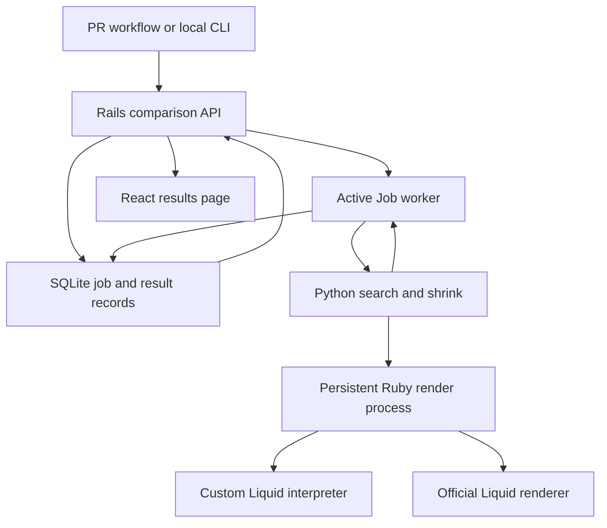

# Shopify Liquid Regression Finder
## Implementation plan for Google Antigravity

Build `liquid-regression-finder`, a pull-request tool that takes before and after Liquid snippets, generates products, finds a change in sale-badge presence, and returns a minimized, replayable fixture with both rendered outputs and the condition values that explain the change. Start from an empty repository. The first release analyzes a standalone product-card fragment. The benchmark adds separate sold-out and price-range detectors through the same engine.

This document describes work to implement and verify. Benchmark measurements, compatibility results, and live Shopify observations are deliverables of the build stages.

## 1. Start here in Antigravity

Put this file at the repository root. Open the project in Antigravity and paste the following into the main agent conversation. Inspect worker status in Agent Manager, or use `/agents` in Antigravity CLI.

```text
Read Shopify-Liquid-Regression-Finder-Implementation-Plan.md and any existing repo instructions. Act as the build coordinator. Follow the stage protocol in section 2. Invoke one implementation subagent for the first unfinished stage, passing its stage card, relevant contract sections, paths, gate commands, and the current checkpoint. Wait for it to return and exit. Verify the gate locally and save the checkpoint. Use automatic mode to advance through passing stages in order. Keep at most one worker active. If delegation is unavailable on this surface, tell me and give me the exact stage prompt to launch in Agent Manager. Start building now.
```

| Follow-up message | Coordinator behavior |
|---|---|
| `run next thing` | Read disk state. Resume the first unfinished stage at its next recorded task, or start the next stage if the preceding gate passed. Execute one stage, then pause. |
| `continue automatically` | Resume the first unfinished stage and advance through passing stages until a stop condition or release completion. |
| `status` | Show stage, checkpoint, last passing command, blocker if any, and next command. Keep the active run unchanged. |

The coordinator uses Antigravity's subagent capability where exposed. Agent Manager makes worker state visible. A worker gets its own context, so each delegation must carry the path to this plan and the relevant state rather than relying on the main chat history. [Antigravity subagents](https://antigravity.google/docs/subagents)

## 2. Stage protocol

1. **Read state.** Keep `docs/implementation-progress.md` in the repo. Record the current stage and status (`pending`, `running`, `paused`, `blocked`, `passed`), completed tasks, exact command and exit status for every gate, evidence paths, remaining tasks, next command, and changes to assumptions. Use a stage-specific folder under `artifacts/` for detailed logs. Ignore transient logs in Git.
2. **Dispatch one worker.** Use the working repository and give the worker one stage only. Include permitted files, dependencies, the required output, and the gate. Workers do not spawn workers, start the next stage, or rewrite contracts from a passed stage without reporting the change. Keep user edits. Local checkpoints are sufficient and no remote publish is needed to build.
3. **Bound the run.** Target a visible checkpoint in 20–30 minutes of active work and cap a single attempt at 45 minutes. Use terminal timeouts on commands that could hang. With 10 minutes of the attempt left, finish the smallest verifiable task and record the commands to resume. Stop earlier if the same gate fails after two targeted fixes without new evidence, an external prerequisite is missing for the current gate, or the implementation is drifting toward stubs, relaxed assertions, or hard-coded demo inputs. Schedule a fresh attempt from the last checkpoint. The stage estimates below cover human implementation and review over multiple attempts.
4. **Verify and hand off.** The worker reports changed files, gate output, and any loose ends, then exits. The coordinator reruns the stage gate and inspects boundary inputs and outputs. A stage passes only when all its required checks, including specified regression checks from earlier stages, pass. Optional probes have explicit evidence states defined below. If passing, record the evidence and dispatch the next worker in automatic mode. If stopped, record the most specific blocker, whether a retry can proceed unaided, and the exact next action. End with `Say "run next thing" to resume Stage N at TASK.` A dependency failure keeps the dependent stage pending.
5. **Release only from evidence.** Stage 10 checks the clean-checkout path and all required deliverables. A green unit test, a working screenshot, or a finished worker session by itself does not satisfy a stage gate.

## 3. Architecture and repository



The CLI calls the Python search directly. Python runs one Ruby subprocess per job over UTF-8 JSON Lines and sends sources once, then one fixture per request. Ruby owns template compilation, product projection, HTML parsing and both render engines. Rails manages asynchronous jobs and persistence. React reads the persisted result. The official gem is a reference, and `liquid-spec` drives the standalone interpreter in isolation.

| Path | Contents |
|---|---|
| `interpreter/` | Lexer, parser, AST, environment, evaluator, tracer, tests and liquid-spec adapter |
| `reference/` | Official-gem renderer, product projection, HTML observers, storefront probe and JSONL worker |
| `search/` | Python package, deterministic generation, comparison, shrinking, trace alignment and CLI |
| `api/`, `web/` | Rails API and worker, React + TypeScript UI |
| `contracts/` | JSON Schema files, protocol fixtures and shared validation examples |
| `fixtures/` | Demo templates, ordinary passing products, and separate regression-test and replay artifacts |
| `bench/` | Dawn case manifest, extracted fragments, sample baseline, runner and generated report |
| `bin/`, `docs/`, `.github/workflows/` | Verification entry points, operational docs and PR integration |

Keep Python for generators, deterministic candidate enumeration, shrinking and the benchmark. A Ruby-only runner would remove a process boundary and simplify deployment. Here the one long-lived subprocess makes the boundary measurable and gives Ruby a single ownership point for Liquid behavior. Use standard-library Python for search and process management. Pin a supported Ruby, Python and Node toolchain and compatible Rails, Solid Queue, Liquid, liquid-spec and Nokogiri versions in Stage 1. Record exact tested versions and the liquid-spec SHA. Commit lockfiles. Run shell commands from the repo root unless a stage command explicitly changes directory.

## 4. Exact data contracts

Implement JSON Schemas using Draft 2020-12. The notation below specifies required keys unless marked `?`, meaning absent or present with the stated type. Objects reject extra keys. JSON means JSON primitives, arrays and string-keyed objects. Use lower snake case throughout. Serialize replay artifacts as sorted-key UTF-8 JSON with compact separators, unchanged array order and no NaN; hash exact UTF-8 snippet bytes with SHA-256.

```text
Fixture = {schema_version: 1, currency: "USD", variants: Variant[1..8]}
Variant = {id: string[1..32], price: int[0..10000000],
           compare_at_price: int[0..10000000] | null, available: bool}
Span = {start_byte: nonnegative_int, end_byte: nonnegative_int,
        line: positive_int, column: positive_int}
Frame = {loop_id: string, iteration: nonnegative_int, variant_id: string | null}
TraceEvent = {seq: nonnegative_int, node_id: string, scope: Frame[],
              span: Span, data: Lookup | Comparison | Branch | Assignment | Emit}
Lookup = {kind: "lookup", path: string, found: bool, value: JSON}
Comparison = {kind: "comparison", op: "=="|"!="|"<"|"<="|">"|">=",
              left: JSON, right: JSON, result: bool}
Branch = {kind: "branch", expression: string, condition: bool, taken: bool}
Assignment = {kind: "assignment", name: string, value: JSON}
Emit = {kind: "emit", output_start_byte: nonnegative_int,
        output_end_byte: nonnegative_int, active_branch_seqs: nonnegative_int[]}
Diagnostic = {code: string, message: string, span: Span | null}
RenderResult = {status: "ok"|"error", html: string | null, observed: bool | null,
                events: TraceEvent[], error: Diagnostic | null}
Snippet = {source: string}
Budget = {search_pairs: int[1..5000], shrink_pairs: int[0..1000]}
CompareRequest = {schema_version: 1, before: Snippet, after: Snippet,
                  observer: "sale_badge", seed: int[0..4294967295], budget: Budget}
Anchor = {line: positive_int, event_seq: nonnegative_int}
Explanation = {kind: "aligned_change"|"structural_change"|"undetermined",
               before: Anchor | null, after: Anchor | null, summary: string}
ReplayBundle = {request: CompareRequest, fixture: Fixture,
                before_sha256: string, after_sha256: string,
                interpreter_version: string, liquid_version: string,
                projection_version: string}
Projection = {price: int, price_min: int, price_max: int, price_varies: bool,
              compare_at_price: int | null, compare_at_price_min: int | null,
              compare_at_price_max: int | null, compare_at_price_varies: bool,
              available: bool}
Finding = {product: Projection, replay: ReplayBundle, before: RenderResult, after: RenderResult,
           reference: {before: RenderResult, after: RenderResult},
           explanation: Explanation}
Stats = {search_pairs: nonnegative_int, shrink_pairs: nonnegative_int,
         parity_rejections: nonnegative_int, exhausted_by: "pair_limit"|"candidate_space"|null,
         first_difference_ms: nonnegative_int | null, elapsed_ms: nonnegative_int}
ComparisonJob = {schema_version: 1, id: UUID, status: "queued"|"running"|
                 "difference_found"|"no_difference_found"|"failed",
                 request: CompareRequest, finding: Finding | null, stats: Stats | null,
                 error: Diagnostic | null, result_url: string, created_at: RFC3339,
                 completed_at: RFC3339 | null}
```

Variant IDs are unique. Cents are integer values, with no floats or formatted prices in fixtures. Spans use half-open byte offsets in original source and one-based line and Unicode code-point column. Trace sequence resets per render and follows actual evaluation order. Node IDs derive from AST path and kind and are local to a template. A lookup distinguishes a missing key from a present null. Snapshot JSON data by value when tracing. Render success has HTML, a Boolean observation and null error. Render error has null HTML and observation, a structured diagnostic and no published finding. Reference results use empty events. Active jobs have null terminal fields. A finding includes both successful trace-enabled renders and both successful reference renders. Failed jobs have a diagnostic and may have partial stats.

JSONL requests use unique string `id`, `op`, and arguments. Define `compile` with before and after source plus observer, `render_pair` with fixture, `engine` (`custom` or `reference`) and `trace` Boolean, and `quit` with no arguments. Each response echoes ID and contains exactly one of `result` or `error`. Compile returns both source hashes. Render returns `{before: RenderResult, after: RenderResult, product: Projection}`, with the projection sourced from Ruby. Compile both engine pairs once and store them in process. Benchmark observers use the same protocol enum extended in Stage 7. Their projected snippets remain separate from public API submissions.

## 5. Engine, product semantics and search

### Interpreter

- Lex text, output and tags as distinct token types. Keep raw source spans. Apply left and right whitespace trimming at token boundaries while retaining original offsets. Accept UTF-8 and normalize neither markup nor whitespace beyond Liquid rules.
- Parse a nested AST with `Text`, `Output`, `Assign`, `Conditional` (ordered arms and optional else), and `For` (loop binder, collection and body). Expressions use `Literal`, `Path`, `Compare`, and `Logical`. Initially implement dot access, identifiers, strings, integers, booleans and nil, `if/elsif/else/unless`, and array iteration. Reject unsupported nodes, unmatched end tags and invalid operands at the appropriate phase. Implement grammar whole-template checks and structured line-aware errors. Extend only from verified conformance cases or benchmark needs.
- Evaluate a compiled AST against fresh JSON assigns on every render. Permit data lookups only and return nil for missing lookups in the chosen permissive variable mode. Test assignment visibility across nested loops, loop-variable shadowing and restoration, including assignment after the loop. The demo depends on an assigned sale flag surviving iteration.
- Liquid treats nil and false as falsy. Evaluate chained logical expressions with Liquid's right grouping and actual short-circuit behavior, exercising lookup ordering in traces. Use oracle probes for nil comparisons in both operand orders, mixed numeric/string operands, unequal strings, equality and errors, and independently verify condition inversion and branch fallthrough. Pin expected outcomes to the locked gem. Never coerce money strings, zero or null into each other. [Liquid operators](https://shopify.github.io/liquid/basics/operators/) · [Liquid truthiness](https://shopify.github.io/liquid/basics/truthy-and-falsy/)
- Tracing is an evaluator side channel. Emit events only for executed lookups, comparisons, selected/evaluated arms, assignments and output ranges. Capture the actual template operand values. Assert that enabling tracing leaves rendering byte-for-byte identical. Record nested loop frames and the variant ID when iterating a product variant. A `for` body is evaluated once per enumerated entry in order.
- Enforce resource limits in both engines: each snippet at most 16 KiB, depth 32, 50,000 evaluation steps, 128 KiB output and 10,000 trace events. Use the gem's resource limits where available and the host subprocess timeout as a backstop. Report a structured limit error. Apply a 90-second hard job deadline to execution after claim. Cap individual JSONL requests at five seconds and stdout response frames at 16 MiB. Separate protocol stdout from logs and reap the process on failure. Confirm limits with stress tests rather than relying on settings alone.

### Product projection and parity

| Projected Liquid input | Rule |
|---|---|
| `product.variants` | Same order and values as fixture, with stable IDs and explicit variant-level nulls |
| `product.price`, `price_min`, `price_max` | Minimum, minimum, maximum variant price respectively |
| `product.price_varies` | Whether min and max differ |
| `product.available` | Whether any variant is available |
| `product.compare_at_price`, `compare_at_price_min`, `compare_at_price_max` | Initial projection uses min/min/max of numeric compare-at values, including zero and excluding nil. All nil yields nil. |
| `product.compare_at_price_varies` | Initial projection uses two or more distinct numeric compare-at values. All nil yields false. |

The price and compare-at minimum relationships come from Shopify's product documentation. The initial aggregation rules for mixed nil, zero and explicit values are a versioned local model until checked on a live storefront. [Shopify product Liquid object](https://shopify.dev/docs/api/liquid/objects/product) · [Shopify variant Liquid object](https://shopify.dev/docs/api/liquid/objects/variant)

Use one projection in Ruby and deep-copy the projected data per engine and snippet. Run a separate Shopify probe on a development store when available. Create or select test products for all-null, null plus positive, explicit zero plus positive, equal numeric values, varied numeric values, and mixed availability. Use a draft theme template to output each aggregate and variant field through a JSON representation, then record storefront observations, date, currency/market and whether explicit zero is retained. Compare with local projection output. If the probe contradicts it, version the projection, update tests, and rerun demo and benchmark. If store access is unavailable, ship the probe and matrix with status `storefront_unverified`, label that gap in the docs/report, and scope product claims to the local model. The gem parity test verifies both shoppers' badge outcomes given identical projected inputs. Keep live field verification as separate evidence.

### Search, shrink and replay

- The sale observer parses rendered HTML with Nokogiri, querying `[data-regression-badge="sale"]` in a standalone fragment. The protocol counts markup presence. Decoy strings, comments, escaped HTML and sold-out markers do not match. Snippets use the marker on the actual badge element, and docs explain this integration requirement.
- Baseline demo assigns `on_sale = false`, loops over `product.variants`, sets the flag when a non-nil compare-at price exceeds that variant's price, then renders the badge once when the flag is true. Edited demo emits the same badge when product-level compare-at price exceeds product price. Keep nil guarding explicit where required by the locked reference behavior. Use a separate ordinary fixture for the smoke test and generate the failing fixture through search at runtime.
- Enumerate single-variant and ordered multi-variant boundary combinations using generic relative price categories (missing, zero, below, equal, above), prices around zero and simple monetary amounts, and availability masks. Include equal prices, varied prices, mixed compare-at categories, and position changes in the first coverage pass. Use stable iteration and deduplicate canonical fixtures. Follow with seeded sampling for up to eight variants, biasing toward shared prices and mixed sale states. Version the generator and define `random.Random(seed)` against the pinned Python runtime. The same request yields the same candidate order. Predeclare an attempt cap on sampling duplicates and use a stable exhaustion reason when it is reached.
- Default to 256 search pairs, 128 shrink pairs, seed 0. Increment a pair counter for each attempted unique fixture rendered by the custom engine during that phase. Evaluate two snippets for every fixture. If the outcomes differ, render both snippets in the official gem. Require matching before/after observations individually and matching direction of change. Record candidate parity rejections and continue. A render/protocol failure terminates with a diagnostic. If no confirmed case remains and any candidate failed parity, return `failed` with `reference_mismatch` instead of an ambiguous negative. An ordinary negative displays “no difference found within this search” and the number of pairs tried. Use the watchdog as a failure, separately from deterministic pair limits.
- Shrink only a confirmed case. Accept neighbors preserving the same before/after outcomes in both engines. Remove variants first (ordered chunk deletion, then single removals, keeping at least one). Then simplify one field at a time toward nil, zero, equality, each other or the closest price boundary. Try price and compare-at paired simplifications when either alone would lose the result. Order proposals by a strict descending measure such as lexicographic `(variant_count, non_null_compare_at_count, total_cents, true_availability_count, canonical_fixture_bytes)`, accept only strict decreases, cache tested states and restart after an accepted change. Keep stable IDs while shrinking so explanation links survive. On budget exhaustion return the last confirmed fixture and its shrink stats. Use “minimized fixture.” Report a local fixed point only if the complete specified neighborhood was checked.
- Finish by re-rendering the minimized fixture with tracing and independently rerunning reference parity. `replay` takes the exact bundle, validates projection and engine versions and hashes, bypasses generation and shrinking, and reproduces both HTML strings, stable trace events and reference observations. Use structural comparison of timestamps-free results. Save provenance and timings in separate fields.
- For the explanation, identify the recognized badge element, then find its opening-tag range in the source HTML using a token walk that preserves byte offsets and ignores comments, quoted attribute contents and raw text. Pair it with the DOM match only when the mapping is unambiguous. Join overlapping emit ranges to their recorded active branch sequence numbers. Test tags assembled from multiple emits and fall back to undetermined for ambiguous attribution. Include executed control conditions and the last relevant assignment to a flag read by those controls, retaining loop variant IDs. Align across versions using unique normalized condition fingerprints, syntax ancestry, and matching loop context or stable variant IDs. Use surrounding source diff anchors only to disambiguate genuine matches. Prefer an aligned branch that changed and lies on a path to the observed output. For the demo, the expressions are structurally different. Report the before variant ID and compare-at/price operands, then the after aggregate operands and control line. Mark structural evidence explicitly. If alignment is ambiguous, show both traces and mark the explanation undetermined.

## 6. Build stages

The commands in the tables are required deliverables of their stage. Implement a root `bin/check stage-N` dispatcher in Stage 1 and extend it as each stage lands. Each command must fail if any required check fails. Underlying tests must also be runnable individually.

| Stage | Worker | Human estimate | Gate and visible result |
|---|---|---:|---|
| 1 | Bootstrap and conformance adapter | 3–5 h | `bin/check stage-1` verifies pinned tools, installs from locks and runs a real plain-text spec through the custom renderer. |
| 2 | Liquid engine | 7–11 h | `bin/check stage-2` verifies grammar, rendering, tracing and the frozen conformance selection. |
| 3 | Shopify projection and reference | 4–7 h | `bin/check stage-3` renders positive and negative ordinary products in both engines and checks JSONL and product semantics. |
| 4 | Counterexample search | 5–8 h | `bin/check stage-4` finds the demo without a failing seed fixture and returns an ordinary budget-limited negative for identical inputs. |
| 5 | Shrink, explanation and replay | 5–8 h | `bin/check stage-5` runs all four core acceptance checks end to end. |
| 6 | Dawn corpus | 5–9 h | `bin/check stage-6` validates provenance and reference reproducibility for 10–20 cases. |
| 7 | Benchmark and any needed engine extensions | 6–11 h | `bin/check stage-7` regenerates the report and checks case accounting, reproducibility and baseline execution. |
| 8 | Rails API and jobs | 5–8 h | `bin/check stage-8` verifies API, queue, recovery and persisted result links. |
| 9 | React results UI | 5–8 h | `bin/check stage-9` runs type checking, UI tests and a real API-to-browser demo. |
| 10 | PR workflow and release | 4–7 h | `bin/check all` passes from a clean checkout and a PR dry run emits the result URL. |

Total estimate **49–82 hours**, roughly **5–9 weeks at 10 hours/week**. Store access, Dawn provenance research and revision cycles can extend elapsed time.

### 1 · Bootstrap and conformance adapter

- Initialize structure, pinned runtimes, lockfiles and reproducible install commands. Establish schema examples, small diagnostics and the plain-text compile/render API. Add tests that prove the adapter calls the custom code. The first working render must use the custom text node.
- Use the pinned liquid-spec Ruby DSL `LiquidSpec.setup`, `configure`, `compile` and `render`. Store the compiled AST in context and use one render state per invocation. Confirm supported modes, flags and runner output in that revision. Keep the generated upstream guidance scoped to the adapter if used. [liquid-spec adapter and CLI](https://github.com/Shopify/liquid-spec)
- Inventory pinned cases. Freeze a versioned manifest of cases whose required features fit Stage 2. Include applicable `basics` and `liquid_ruby` literal, output, access, assignment, conditional and loop cases. Record reasons for skipped modes or features such as unsupported filters, Drops, partials, Shopify extensions and parser error wording/mutation suites. Report suite totals, selected/pass/fail/skip counts, and both pass/selected and pass/inventoried denominators. Keep failure IDs visible. Selection is based on feature scope before execution. Commit the exact working runner invocation and pilot output in the progress record.

### 2 · Liquid engine

- Work in order: lexer and spans, parser and block terminators, evaluator/scopes, trace and resource limits, then conformance fixes. Add step tests for mixed HTML, multiline tags, trim markers, malformed syntax, branch fallthrough, nested loops, shadowing, copied trace values and deterministic event ordering.
- Probe the same test snippets against the locked gem for nil, mixed-type comparison, mixed logical operators, short-circuiting and assign visibility. Pin the observed semantics in tests. Require all frozen in-scope cases to pass. Widen the manifest only alongside a deliberate capability change and report before/after counts.
- Gate on Stage 1 and interpreter checks. End with a nested-loop fragment rendered by the custom engine and an inspectable trace.

### 3 · Projection and reference

- Implement fixture validation, projection, marker observation and the process protocol. Add official-gem rendering using a restricted environment, disabled host includes and no external filters or filesystem access. Use identical inputs but independent render state.
- Test mixed nil/zero, all nil, equal and varying numeric prices, availability, missing keys, duplicate IDs, whitespace, fake badge markers, resource limits and reference errors. Ship the storefront probe instructions and observation matrix. Set the evidence state per section 5. Gate on ordinary sale and ordinary non-sale fixtures with both renderers, distinct from generated regression fixtures.

### 4 · Counterexample search

- Implement JSONL client, seeded generation, candidate budget, early parity rejection handling, and `compare` CLI returning machine-readable results. Use injected fake worker tests for error/timeout/mismatch paths and real worker tests for demo behavior. Gate on known-change discovery across several pinned seeds and identical templates exhausting a small test budget. Run with a fixture directory containing only the snippet sources and ordinary controls to prove search owns discovery.
- Keep a generated report with seed, candidate index, direction, counts and reference status. This is the initial working CLI demo. Establish these public commands, with stdout reserved for machine-readable JSON, stderr for diagnostics, and exit codes 0 for an ordinary negative or successful replay, 1 for a confirmed comparison change, and 2 for errors. Implement replay and bundle output in Stage 5.

```sh
python -m search compare --before fixtures/demo/before.liquid --after fixtures/demo/after.liquid \
  --observer sale_badge --seed 0 --search-pairs 256 --shrink-pairs 128 \
  --replay-out artifacts/demo-replay.json
python -m search replay --bundle artifacts/demo-replay.json
```

### 5 · Shrink and replay

- Implement the ordered shrinker, final traced render, explanation calculation and `replay` CLI. Test deletion and field simplification, preserving direction and reference parity, proof of termination on tiny budgets, zero shrink budget, replay from disk in a fresh process, structural and aligned explanations, and ambiguous candidates.
- Gate on original and minimized fixture both reproducing the direction, minimized measure no worse, an intentionally oversized partition test strictly improving, exact stable replay, both reference outcomes agreeing, and evidence lines that locate the evaluated demo conditions.

### 6 · Dawn corpus

- Mine 10–20 distinct cases from Shopify Dawn issues, PRs and commit history. Start with [missing sale badge with a zero compare-at price](https://github.com/Shopify/dawn/issues/3581), [compare-at price variation](https://github.com/Shopify/dawn/issues/871) and [CSS-driven badge visibility](https://github.com/Shopify/dawn/issues/3924). Treat these as leads and establish whether each has a real, reproducible before/after pair. The last lead needs a visibility predicate tied to the relevant parent class or a separate unsupported entry. Check [Dawn card-product](https://github.com/Shopify/dawn/blob/main/snippets/card-product.liquid) and [Dawn price](https://github.com/Shopify/dawn/blob/main/snippets/price.liquid) history.
- Record case ID, observable, symptom, issue/PR URL, before and after SHAs, upstream paths, extraction/transformation notes, pinned reference witness, direction, expected observations, and a license/provenance note. Include at least one verified case for each observable. A shortened fragment must preserve the relevant branch and be validated against the upstream behavior or a documented upstream reproduction with its required context. Preserve bug/revert direction as authored and label it. Store witness files apart from search and sample inputs.
- Record candidates that lack evidence separately. A report with fewer than 10 verified real cases stays incomplete. The worker stops at a documented corpus checkpoint if it runs out of time and resumes mining on the next stage attempt. Never multiply one bug into several cases using fixture variations.

### 7 · Benchmark

- Add benchmark-only observers `sold_out_badge` (marked element) and `price_range` (presence of a range selected by the original branch). Document case-specific selector and visibility semantics and test against extracted before/after outputs. Extend supported Liquid in the smallest coherent feature groups indicated by the frozen cases. Add each real language feature with oracle checks and update the conformance manifest. Use fixed context for inputs unrelated to the change and disclose all extractions. Track unsupported verified cases explicitly in headline accounting and in a supported-only view.
- Compare generated search with a pinned, sourced set of Shopify default sample products rendered through the same observer and official parity path. Record where they came from and how they were projected. Keep the sample baseline unavailable as a verified metric if the official sample set cannot be obtained, and keep the corresponding benchmark gate open. Additional synthetic ordinary products may be reported separately with their provenance.
- Freeze case list, seeds, generator version and budget before measuring. Run each case/seed across both methods on the same pinned environment. The sample baseline considers each sample once up to the common maximum pair count and records how many are available. Give both methods the same shrink budget after detection and report pre- and post-shrink size. Record end-to-end time to confirmed finding including startup and parity, separate shrink time, detection rate, evaluated pairs, fixture variant count and bytes. Report per-case outcomes (`detected`, `budget_exhausted`, `unsupported`, `error`), rates with denominators and median timing over detections, plus conformance coverage and instrumented render-process overhead. Output CSV and a generated Markdown summary. Gate on accounting for all verified cases and reproducing all deterministic fields, even when not all cases are detected.

### 8 · Rails API and asynchronous persistence

- Use Rails API mode, SQLite and database-backed Solid Queue. Run a single job worker for the demo. Create a comparisons table for UUID, status, request JSON, request digest, unique optional idempotency key, result JSON, stats, diagnostics, attempt token, lease and timestamps. Validate size, types, supported observer and budget. Compute digest without whitespace normalization of Liquid. POST `/api/v1/comparisons` returns 202 and a result link. GET `/api/v1/comparisons/:id` returns ComparisonJob. Use structured 404, 409 (same key, different digest) and 422 responses. Treat duplicate same-key, same-digest requests as the same comparison.
- Persist the queued row before enqueue. Recover queued rows missed during enqueue using a periodic reconciliation entry point. Claim queued rows with an atomic compare-and-set on state, increment attempt, and set a lease longer than the watchdog. Use the attempt token to guard a single transactional terminal write including result or error. Requeue expired claims once, then fail with diagnostic if another attempt expires. Retry infrastructure failures only within that bound and leave validation/engine failures terminal. Test duplicate delivery, stale writes, lease recovery and persistence across restarts. Use argv subprocess calls, bound execution, reap descendants and validate all worker responses. Redact source and fixture data from default server logs.
- Local UI uses a same-origin dev proxy. For a shared PR preview, deploy behind repository/team access control and protect CI submission with a scoped credential supplied by environment. Build and test the local path without deployment credentials. Never accept an arbitrary filesystem source path through the API.

### 9 · React results page

- Build a submission route for before/after source and budget, and `/comparisons/:id` for results. Poll active jobs with backoff, cancel polling on unmount and stop on terminal state. Provide actionable error, loading, timeout, missing job, and exhausted-budget states. Display actual examined counts and parity status.
- Show a variant table and derived fields, the two rendered HTML strings as escaped text, and highlighted original source lines for both condition anchors. Include loop variant IDs, typed operands and expandable event traces. Provide a replay JSON download and show replay command. Use text labels in addition to color, keyboard navigation, and responsive stacking on small screens. If adding a rendered preview, use a sandboxed iframe and a default-deny content security policy so submitted HTML cannot execute or load network resources.
- Test all job states and real API integration. Verify a second page load on the result URL reconstructs the same view. Include a browser test proving submitted markup cannot execute in the results page.

### 10 · Pull-request workflow and release

- Document a comparison manifest for a configured repo-relative snippet path and its sale marker. CI reads exact before/after blobs from the PR base and head SHA through Git. Check for missing or renamed blobs and report a diagnostic. Pass bytes via JSON or files without interpolating Liquid into shell commands. Create an idempotency key from repository, commit pair and manifest digest. Submit, poll with a bounded deadline, and emit the result link and seed in the GitHub Actions job summary. Fail the job for a confirmed change or infrastructure failure and pass ordinary budget exhaustion with the scoped message. Test token handling and fork behavior. Use the GitHub workflow's job check and summary as the PR integration. Keep external secrets out of untrusted fork execution. A local dry run against Rails must exercise both expected exit codes and the result URL path.
- From a clean checkout run setup, all gates, the CLI demo and replay, benchmark, and a PR dry run. Produce a first-run README with commands, limitations and coverage. Confirm suite counts and timings come from generated evidence. Report separately whether the shared deployment, PR check on a live repository, and storefront fixture probe were exercised. These require a host or store made available for that purpose.

## 7. Release checklist and scope choices

| Required outcome | Evidence |
|---|---|
| Known badge change found without a supplied witness | Stage 4 generation log and Stage 5 real CLI acceptance output |
| Identical snippets return a scoped negative | Pair counts and terminal status from tests |
| Minimized JSON reproduces both HTML outputs and branch traces | Fresh-process replay and all deterministic fields compared |
| Official Liquid confirms both sides | Before/after observations and pinned reference version in finding |
| Conformance coverage is measurable | Frozen manifest, per-suite counts, skip reasons and failures |
| Dawn benchmark is credible | 10–20 unique cases with provenance, pinned sample baseline, reports, coverage and explicit unsupported/error counts |
| Normal UX goes from PR or submission to result and replay | API and queue tests, Playwright path, resumable result URL, and PR dry run |

Keep Ruby, Python, Rails and TypeScript. Ruby-only search is the first simplification to reconsider if measured process overhead is material, after preserving parity and replay contracts. Prioritize cuts in this order if time runs short.

1. Keep escaped output and omit the optional iframe preview. The result still shows both rendered outputs and the condition evidence.
2. Keep one worker, a local demo and GitHub's built-in check summary. Custom Checks API publishing, multi-user administration and production scaling are outside the planned build.
3. Keep the public API scoped to the sale badge and a configured standalone fragment. Add only the benchmark-specific observers and necessary syntax. Whole-theme execution, arbitrary selectors and broad Shopify object parity are later work.
4. Land a CLI milestone early if the schedule runs out. Mark Rails, UI, PR or benchmark work as pending until their gates actually pass.

The build's most material unresolved assumptions are how the live storefront aggregates missing compare-at values and how many well-evidenced Dawn cases can be reproduced with a compact interpreter. The storefront probe and the corpus gate make both outcomes visible before any stronger release claim.
